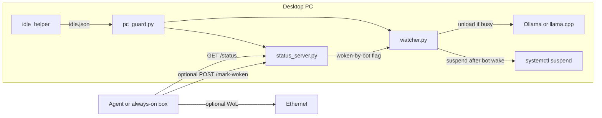

# pc-guard

Keep a local LLM from running while someone is using the PC, and optionally put the machine back to sleep after a bot wakes it.

The PC is **not busy** when all of these are true:

- no keyboard or mouse input for a configurable period (default 15 minutes)
- no game process is running
- no unexpected GPU load (default: above 15% util, or a non-model, non-desktop process using 512 MB or more of VRAM)

Agents should check `GET /status` before they load or call a local model. If the PC becomes busy mid-job, the watcher unloads the model. If a bot woke the PC, the watcher can suspend it again once it is idle.

## How it works



Three systemd **user** services run in the logged-in user's session (linger is recommended so they start after a reboot even before a login):

| Service | Role |
| --- | --- |
| `pc-guard-idle` | Talks to the compositor via KDE KIdleTime and writes `$XDG_RUNTIME_DIR/pc-guard/idle.json` |
| `pc-guard-status` | Serves `GET /status` on localhost and, by default, the Tailscale IPv4 address |
| `pc-guard-watcher` | Unloads models when the PC turns busy; auto-suspends after a bot wake |

Busy is decided if any of these is true:

1. **Recent input.** On KDE Wayland the helper is the accurate source (`KIdleTime::idleTime()` itself often returns 0 on KWin, but `timeoutReached` / `resumingFromIdle` work). If the helper starts mid-idle, its count is a lower bound; if the screens are already DPMS-off or the screensaver is active, the configured input window is treated as already satisfied. If the helper is not running, `xprintidle` (X11) and GNOME's Mutter IdleMonitor are tried. Unknown idle time is not treated as activity.
2. **A game process**, such as Steam's reaper/`steamapps/common`, gamescope, Wine/Proton, Lutris, or Heroic. The Steam client itself is not a game. Extra regexes are configurable.
3. **GPU load** that is not from a local model (Ollama or llama-server) and not from the desktop compositor. NVIDIA is measured with `nvidia-smi`. AMD util is best-effort only.
4. The test flag `$XDG_RUNTIME_DIR/pc-guard/simulate-busy`.

The watcher does not take a sleep inhibitor, so it does not block the normal session sleep timer.

## Requirements

- Linux with **systemd** (user services). Python 3.9+ (stdlib only).
- **Idle time:** for KDE Plasma, build `idle_helper` (Qt6 or Qt5 plus KIdleTime). On X11, `xprintidle` is a fallback. On GNOME, Mutter's IdleMonitor over D-Bus is a fallback.
- **GPU:** `nvidia-smi` for NVIDIA. AMD is a limited fallback (`gpu_busy_percent` or `rocm-smi`) without per-process VRAM. Set `gpu_backend=none` to skip GPU checks.
- **Unload:** `ollama` on PATH, or an `unload_hook` script for llama.cpp / another server.
- **Optional:** Tailscale (for the default bind list), `ufw` or another firewall, `ethtool` and `wakeonlan` if you use Wake-on-LAN from another machine.

## Install

1. Clone this repo to a stable path, for example `~/pc-guard`.
2. Copy and edit the config:

   ```
   mkdir -p ~/.config/pc-guard
   cp pc-guard.conf.example ~/.config/pc-guard/pc-guard.conf
   ```

   Or keep a `pc-guard.conf` next to the scripts. Environment variables `PC_GUARD_*` override the file.

3. On KDE, build the idle helper (see the Makefile for distro packages):

   ```
   make
   ```

4. Install and start the user services (no root):

   ```
   ./scripts/install-user.sh
   ```

5. Once, with sudo, for linger, a Tailscale-only firewall rule, and a Wake-on-LAN check:

   ```
   sudo ./scripts/sudo-setup.sh
   ```

6. Confirm it answers locally:

   ```
   curl -sS --max-time 3 http://127.0.0.1:8743/status
   ```

To stop and disable:

```
systemctl --user stop pc-guard-watcher.service pc-guard-status.service pc-guard-idle.service
systemctl --user disable pc-guard-watcher.service pc-guard-status.service pc-guard-idle.service
```

Temporarily prevent auto-suspend only:

```
touch "${XDG_RUNTIME_DIR}/pc-guard/no-autosuspend"
```

Logs:

```
journalctl --user -u pc-guard-idle.service -u pc-guard-status.service -u pc-guard-watcher.service -f
tail -f logs/watcher.log
cat "${XDG_RUNTIME_DIR}/pc-guard/idle.json"
```

## Configuration

See `pc-guard.conf.example`. The main knobs:

| Key | Env | Default | Meaning |
| --- | --- | --- | --- |
| `idle_minutes` | `PC_GUARD_IDLE_MINUTES` | 15 | Input inside this window means busy |
| `gpu_util_threshold` | `PC_GUARD_GPU_UTIL_THRESHOLD` | 15 | Percent, when not from a local model |
| `gpu_vram_busy_mb` | `PC_GUARD_GPU_VRAM_BUSY_MB` | 512 | Non-model, non-desktop VRAM |
| `model_idle_before_sleep_minutes` | `PC_GUARD_MODEL_IDLE_BEFORE_SLEEP_MINUTES` | 10 | Wait after last model before auto-suspend |
| `watch_interval_seconds` | `PC_GUARD_WATCH_INTERVAL_SECONDS` | 20 | Watcher poll interval |
| `status_port` | `PC_GUARD_STATUS_PORT` | 8743 | HTTP port |
| `bind` | `PC_GUARD_BIND` | `127.0.0.1,tailscale` | Addresses; `tailscale` is resolved at runtime |
| `model_backend` | `PC_GUARD_MODEL_BACKEND` | `ollama` | `ollama`, `llamacpp`, `both`, or `none` |
| `ollama_host` | `PC_GUARD_OLLAMA_HOST` | `http://127.0.0.1:11434` | Ollama API |
| `llamacpp_url` | `PC_GUARD_LLAMACPP_URL` | `http://127.0.0.1:8080` | llama-server API |
| `unload_hook` | `PC_GUARD_UNLOAD_HOOK` | unset | Command that receives model names |
| `gpu_backend` | `PC_GUARD_GPU_BACKEND` | `auto` | `auto`, `nvidia`, `amd`, `none` |
| `game_patterns_extra` | `PC_GUARD_GAME_PATTERNS_EXTRA` | unset | Extra cmdline regexes, comma-separated |
| `desktop_gpu_names_extra` | `PC_GUARD_DESKTOP_GPU_NAMES_EXTRA` | unset | Extra compositor process names |
| `wol_interface` | `PC_GUARD_WOL_INTERFACE` | auto-detect | NIC for `sudo-setup.sh` |
| `wake_mac` / `wake_broadcast` | `PC_GUARD_WAKE_MAC` / `PC_GUARD_WAKE_BROADCAST` | unset | Used by `scripts/wake-pc` |

## HTTP API

`GET /status` is the only unauthenticated path. It returns JSON:

```json
{
  "busy": false,
  "reasons": [],
  "gpu_util": 0,
  "gpu_mem_used_mb": 400,
  "idle_seconds": 1200,
  "game_running": false,
  "loaded_models": [],
  "ollama_loaded_models": [],
  "checked_at": "2026-11-22T21:00:00-06:00"
}
```

`ollama_loaded_models` is kept as an alias of `loaded_models` for older clients. `busy` is true when `reasons` is non-empty. If the endpoint does not answer, treat the PC as asleep or unreachable and do not assume it is idle.

`POST /mark-woken` is optional. It is served only when `PC_GUARD_WAKE_TOKEN` is set (for example in `~/.config/pc-guard/wake.env`, mode 0600, referenced by the status unit). The request must send `Authorization: Bearer <token>`. On success it writes the `woken-by-bot` flag. The token is never logged. You can also set the flag locally with `scripts/mark-woken`.

## How an agent should use it

Always check `/status` *before* loading or calling a local model:

```
STATUS_URL=http://127.0.0.1:8743/status ./examples/check-status.sh && your-model-command
```

or:

```
python3 examples/check-status.py http://127.0.0.1:8743/status
```

The shell snippet exits 0 if the PC is not busy, 2 if it is busy, and 3 if the endpoint is unreachable. Over a tailnet, point `STATUS_URL` at the PC's Tailscale address or MagicDNS name.

Typical flow when the PC may be asleep:

1. `GET /status`. If it answers and `busy` is true, refuse the job.
2. If it does not answer, an always-on machine on the same LAN may run `scripts/wake-pc` (needs `wake_mac` and `wake_broadcast`) and poll `/status` for a short period.
3. Once `/status` answers and `busy` is false, mark the wake (`scripts/mark-woken` on the PC, or `POST /mark-woken` if a token is configured) and only then call the model.
4. If `/status` later becomes busy, the watcher unloads the model on the PC side. The agent should still stop sending work.

**pi coding agent (pi.dev).** pc-guard does not plug into pi itself. Wrap the command you already use:

```
STATUS_URL=http://127.0.0.1:8743/status ./examples/pi-pre-run-check.sh pi -p "summarize this repo"
```

You can also add a short project instruction that the agent must run `check-status` (or `curl` `/status`) and stop if the PC is busy, before it starts `llama-server` or talks to Ollama.

**Grok Bot.** Two options:

- A **pre-run check** in a skill: call `GET /status` (or the Python snippet) and refuse when `busy` is true or the PC is unreachable.
- An **MCP connector** on an always-on host (often a Pi) that performs the status check, optional Wake-on-LAN, optional `POST /mark-woken`, and only then proxies a short job to Ollama or llama-server. Authenticate the MCP itself; do not put tokens in the URL, a chat, a README, or a commit. This repo does not ship a full MCP server — it is the PC-side gate those connectors should call.

## Security

- **Bind only to localhost plus a private interface** (Tailscale or a LAN address). The default is `127.0.0.1,tailscale`. Do not bind `0.0.0.0` unless you also add authentication and a tight firewall.
- **`GET /status` has no authentication.** It is read-only and is meant to be reachable only on a private network. It can still reveal whether someone is at the PC, whether a game is running, and whether a model is loaded.
- **`POST /mark-woken` requires a bearer token** and is disabled when the token is unset.
- `sudo-setup.sh` adds a ufw rule for the status port on `tailscale0` only, when ufw is present. That is a backup, not a substitute for a careful bind list.
- Do not commit `pc-guard.conf`, `wake.env`, MAC addresses, or tokens.

## Sleeping again after a bot wake

1. Something on the LAN sends a magic packet (`scripts/wake-pc`).
2. Once the PC is up, a bot (or you) runs `scripts/mark-woken` or `POST /mark-woken`.
3. When no model has been loaded for the configured period, there has been no input for the idle window, and no game is running, the watcher clears the flag and runs `systemctl --no-ask-password suspend` (or `loginctl suspend` as a fallback).

It will not suspend if someone is using the PC, a game is running, a model is still loaded, or `$XDG_RUNTIME_DIR/pc-guard/no-autosuspend` exists. The flags live on tmpfs, so a full reboot clears them. The woken flag is also cleared just before suspend so a later manual wake does not immediately sleep again.

## Portability

pc-guard was originally built for a CachyOS desktop running KDE Plasma on Wayland with an NVIDIA GPU and Ollama. This repo generalizes that setup. What travels as-is versus what you will likely change:

| Area | Works as-is | Needs changes |
| --- | --- | --- |
| systemd user units + linger | Most systemd Linux distros | Not applicable on systems without systemd |
| Python services | Any distro with Python 3.9+ | Nothing extra to install |
| Idle on KDE (Wayland or X11) | Build `idle_helper` against KF6 or KF5 KIdleTime | Package names differ; see the Makefile |
| Idle on GNOME | Mutter IdleMonitor fallback, no helper required | Confirm `gdbus` can reach the IdleMonitor on your session |
| Idle on other Wayland compositors (Sway, Hyprland, …) | Not covered | Write a small helper that speaks the idle-notify protocol, or another compositor-specific source, and write the same `idle.json` schema |
| Idle on X11 without KDE | `xprintidle` fallback | Install `xprintidle`; logind `IdleHint` is not trusted (it can stay "no" on some KDE Wayland sessions) |
| NVIDIA GPU | `nvidia-smi` | Same tool on other distros |
| AMD / Intel GPU | Best-effort AMD util only; no per-process VRAM | Extend `gpu_snapshot_*`, or set `gpu_backend=none` and rely on the game-process list |
| Desktop process ignore list | KDE and common GNOME names are built in | Add your compositor with `desktop_gpu_names_extra` |
| Game detection | Steam / Proton / Wine / Lutris / Heroic | Add native titles with `game_patterns_extra` |
| Ollama unload | `ollama stop` plus a keep_alive=0 fallback | Nothing if you already use Ollama |
| llama.cpp | Detection only | Set `model_backend=llamacpp` or `both`, and an `unload_hook`. The watcher will not kill `llama-server` on its own |
| Firewall | ufw rule in `sudo-setup.sh` | firewalld/nftables are documented but not applied automatically |
| Wake-on-LAN | Generic; interface/MAC/broadcast are config | Enable magic-packet wake in firmware and the network manager; install `wakeonlan` on the always-on box |
| Auto-suspend | `systemctl suspend` | Needs permission to suspend without a password in that user session |

## License

MIT. See [LICENSE](LICENSE).
